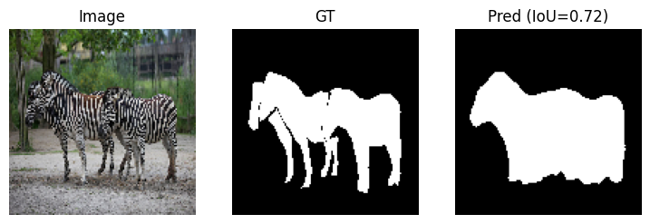
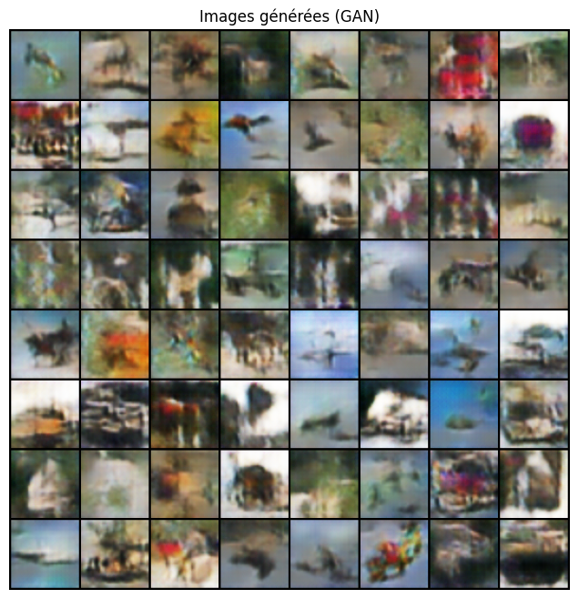

# Image Segmentation with U-Net and DeepLabV3+, and a GAN on CIFAR-10


A practical computer vision study comparing a U-Net with a transfer-learning DeepLabV3+ for binary segmentation on a Mini-COCO subset, followed by a convolutional GAN trained on CIFAR-10.



## Experiments

| Experiment | Data | Training | Best result |
| --- | --- | --- | --- |
| U-Net (128×128) | 3,000 Mini-COCO images | 20 epochs, Adam, BCE with logits | Validation IoU **0.51** |
| DeepLabV3+ with pretrained ResNet-50 | 5,000 Mini-COCO images | 10 epochs, Adam | Validation IoU **0.54** |
| Convolutional GAN | 8,000 CIFAR-10 images | Early stopping at epoch 33 | Qualitative |

The two segmentation experiments use different subset sizes and epoch counts, so their scores are not a strict comparison.

## GAN samples



## Getting started

```bash
pip install -r requirements.txt
jupyter notebook segmentation_unet_deeplabv3_gan.ipynb
```

The notebook downloads COCO 2017 validation images and CIFAR-10 automatically. Expect a large download, and use a GPU.

## Author

**Yassine Houari** · [LinkedIn](https://www.linkedin.com/in/yassine-houari-/)

Completed as pair work.
